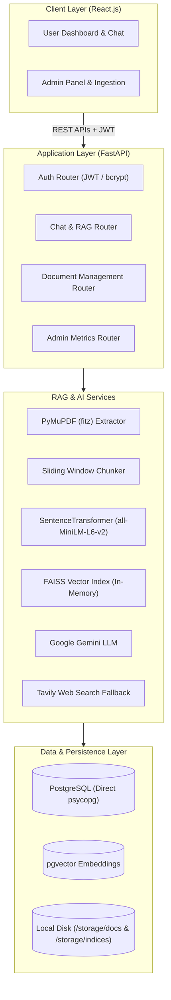
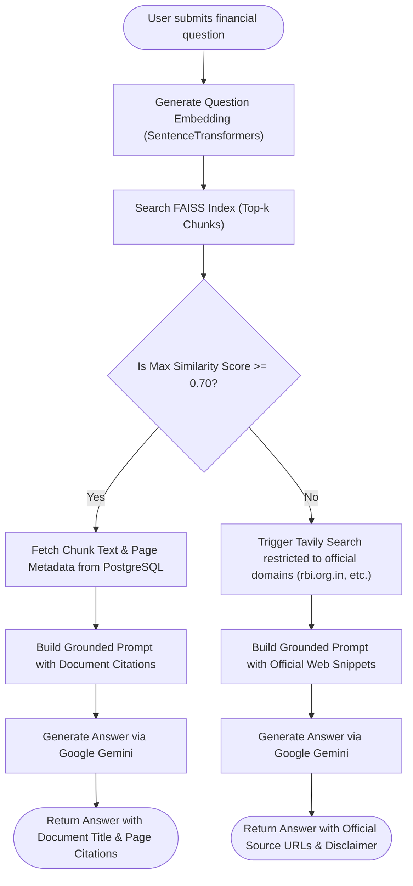

# FinanceAI – An LLM-Based Domain-Specific Financial Assistant Using Retrieval-Augmented Generation (RAG)

[](https://fastapi.tiangolo.com)
[](https://react.dev)
[](https://www.postgresql.org)
[](https://github.com/facebookresearch/faiss)
[](https://ai.google.dev)
[](https://tavily.com)

FinanceAI is a domain-specific financial assistant designed for an MCA final-year project. It bridges the gap between complex regulatory financial documentation and general public comprehension by combining **Retrieval-Augmented Generation (RAG)**, dense semantic embeddings, localized vector indexing, and real-time regulatory web search fallbacks.

---

## 📌 Key Capabilities

- **Strictly Grounded Financial RAG:** Ingests official regulatory PDF circulars (RBI, SEBI, IRDAI, Income Tax, GST, Mutual Funds, Government Schemes) and answers user queries with deterministic document and page-level citations.
- **Dual-Vector Architecture:**
  - **PostgreSQL (`pgvector`)**: Acts as the durable system of record for chunks and embeddings with zero ORM overhead via native `psycopg` drivers.
  - **FAISS (`IndexIDMap`)**: High-speed, in-memory cosine similarity search cache ensuring sub-10ms query responses.
- **Smart Web Search Fallback (Tavily):** When uploaded document context falls below a relevance threshold, queries verified official financial domains (`rbi.org.in`, `incometax.gov.in`, `sebi.gov.in`, `gst.gov.in`, `irdai.gov.in`) with live web links.
- **User & Admin Separation:**
  - **User Portal:** Clean conversational dashboard, chat history management, suggested financial prompts, citation inspections, and answer rating/feedback.
  - **Admin Portal:** Secure document upload & re-indexing pipeline, user account management, RAG health metrics, and audit logs.
- **Zero ORM Standard:** Employs raw, performant, parameterized SQL migrations with native `psycopg` connection pooling to maintain strict database control.

---

## 🏗️ System Architecture



---

## 🔄 RAG Decision Workflow



---

## 💻 Tech Stack

| Component | Technology | Rationale |
| :--- | :--- | :--- |
| **Frontend** | React.js (JavaScript, HTML5, CSS3), React Router v6, Axios | Modern, responsive, decoupled single-page application. |
| **Backend** | Python 3.11+, FastAPI, Pydantic v2, Uvicorn | High-performance asynchronous REST API framework with native OpenAPI docs. |
| **Database** | PostgreSQL 15+ with `pgvector` extension | Relational integrity and durable ACID-compliant vector storage. |
| **Database Access** | Native `psycopg` (v3) connection pool (No SQLAlchemy, No Alembic) | Maximum performance, direct control over SQL, zero ORM overhead. |
| **Vector Search** | FAISS (`IndexIDMap2` wrapping `IndexFlatIP`) | Blazing fast in-memory similarity search without taxing database connection limits. |
| **Embeddings** | `sentence-transformers/all-MiniLM-L6-v2` | Lightweight 384-dimensional dense semantic embeddings ideal for domain text. |
| **PDF Extraction** | PyMuPDF (`fitz`) | Fast, accurate text extraction with strict page-number retention. |
| **LLM Engine** | Google Gemini API (`google-genai` SDK) | Advanced reasoning, instruction-following, and grounded factual generation. |
| **Web Fallback** | Tavily Search API | High-signal search API restricted to official Indian financial portals. |

---

## 🗄️ Database Architecture

The system utilizes raw SQL migrations located in `backend/app/db/migrations/`:

```
users (id, email, full_name, password_hash, role, is_active, created_at, updated_at)
  └── chat_sessions (id, user_id, title, created_at, updated_at)
        └── chat_messages (id, session_id, sender, content, source_type, metadata, created_at)
              └── feedback (id, message_id, user_id, rating, comments, created_at)

documents (id, title, original_filename, storage_path, category, file_size_bytes, file_hash, processing_status, total_pages, total_chunks, created_at)
  └── document_chunks (id, document_id, chunk_index, page_number, chunk_text, token_count, embedding VECTOR(384), created_at)

audit_logs (id, user_id, action, entity_type, entity_id, details, ip_address, created_at)
```

---

## 📁 Repository Structure

```
finance_rag_base_project/
├── README.md                            # Master project documentation
├── IMPLEMENTATION_PLAN.md               # Detailed 8-phase implementation roadmap
├── docs/
│   ├── ARCHITECTURE.md                  # Comprehensive architectural specification
│   ├── API_DOCUMENTATION.md             # REST API schemas and parameters
│   └── DATABASE_SCHEMA.md               # Database DDLs and indexing strategy
├── backend/
│   ├── .env.example                     # Environment template
│   ├── requirements.txt                 # Backend Python dependencies
│   ├── main.py                          # FastAPI server entry point
│   ├── app/
│   │   ├── core/                        # Config, security, dependencies
│   │   ├── db/                          # Connection pool & pure SQL migrations
│   │   ├── models/                      # Pydantic schemas (Request/Response)
│   │   ├── api/v1/                      # Route controllers (Auth, Chat, Docs, Admin)
│   │   ├── services/                    # PDF parsing, embeddings, FAISS, Gemini, Tavily
│   │   └── utils/                       # Logging & validation utilities
│   ├── storage/
│   │   ├── documents/                   # Uploaded PDF circulars
│   │   └── vector_indices/              # Persisted FAISS index files
│   └── tests/                           # Pytest unit & integration test suite
└── frontend/
    ├── package.json                     # Frontend dependencies
    ├── .env.example                     # Frontend environment template
    ├── public/
    └── src/
        ├── components/                  # Navbar, Sidebar, CitationCard, FeedbackModal
        ├── context/                     # AuthContext, ChatContext
        ├── pages/                       # Login, Register, ChatInterface, AdminDashboard
        ├── services/                    # Axios API client
        └── styles/                      # Professional CSS3 design system
```

---

## 🚀 Getting Started & Running the Project

### Option 1: Quick Start in Development Mode (One-Click Launcher)
Ensure PostgreSQL is running locally with a database named `finance_ai_db`. Then execute:
```cmd
run_dev.bat
```
This launcher automatically initializes the backend virtual environment, launches the FastAPI server on `http://localhost:8000`, runs all schema migrations, warms up the FAISS vector index, and starts the Vite React frontend on `http://localhost:5173`.

### Option 2: Production Multi-Container Orchestration (Docker Compose)
Launch the complete stack (PostgreSQL with `pgvector`, FastAPI backend, and Nginx serving the React SPA):
```bash
docker compose up --build -d
```
- **Web Application:** `http://localhost`
- **Admin Portal:** `http://localhost/admin/login`
- **Swagger REST API Docs:** `http://localhost/docs`

---

## 🧪 Automated Test Suite (61 Tests - 100% Passing)

FinanceAI includes a comprehensive automated test suite covering unit operations, security boundaries, RAG retrieval thresholds, FAISS vector synchronization, and full end-to-end user/admin journeys.

To run the complete automated test suite:
```powershell
backend\.venv\Scripts\python.exe -m pytest backend/tests
```

```
collected 61 items

backend\tests\test_admin_api.py .......                                  [ 11%]
backend\tests\test_api_endpoints.py ..........                           [ 27%]
backend\tests\test_auth.py .....                                         [ 36%]
backend\tests\test_chat_and_feedback.py .......                          [ 47%]
backend\tests\test_document_api.py ......                                [ 57%]
backend\tests\test_e2e_flow.py ...                                       [ 62%]
backend\tests\test_faiss_sync.py .....                                   [ 70%]
backend\tests\test_pdf_processing.py ............                        [ 90%]
backend\tests\test_rag_pipeline.py ......                                [100%]

======================== 61 passed in 73.38s ========================
```

---

## 📖 MCA Project Documentation & Evaluation Artifacts

For academic project submission and examiner viva defense, refer to the dedicated documentation in `docs/`:
- **[Formal Technical Project Report](file:///c:/Users/ASUS/Desktop/finance_rag_base_project/docs/PROJECT_REPORT.md):** Complete academic report detailing problem statement, mathematical formulations, zero-ORM architecture, dual-vector design, and security analysis.
- **[Examiner Viva & Evaluation Guide](file:///c:/Users/ASUS/Desktop/finance_rag_base_project/docs/EVALUATION_GUIDE.md):** Step-by-step viva walkthrough script with 7 real-world evaluation scenarios, sample financial queries, and examiner Q&A defense.
- **[Detailed System Architecture](file:///c:/Users/ASUS/Desktop/finance_rag_base_project/docs/ARCHITECTURE.md):** In-depth technical breakdown of the zero-ORM psycopg pool, FAISS RAM synchronization, and RAG grounding gates.
- **[Phase-Wise Implementation Roadmap](file:///c:/Users/ASUS/Desktop/finance_rag_base_project/IMPLEMENTATION_PLAN.md):** Exhaustive 8-phase development roadmap with verification checklists for every milestone.

---

## 📋 Implementation Status Overview

| Phase | Title | Focus | Status |
| :---: | :--- | :--- | :---: |
| **Phase 1** | **Foundation & Auth** | Database setup (`psycopg` pool), SQL DDLs, JWT Auth, User/Admin seed | ✅ **Completed** |
| **Phase 2** | **PDF Ingestion & Embeddings** | PyMuPDF parsing, sliding chunker, SentenceTransformers pipeline | ✅ **Completed** |
| **Phase 3** | **Hybrid Vector Indexing** | `pgvector` persistence, FAISS in-memory sync, deletion cascades | ✅ **Completed** |
| **Phase 4** | **RAG & Tavily Fallback** | Gemini grounding, exact page citations, Tavily official domain fallback | ✅ **Completed** |
| **Phase 5** | **Chat History & Feedback** | User-isolated sessions, multi-turn memory, thumbs up/down ratings | ✅ **Completed** |
| **Phase 6** | **Admin Dashboard** | System observability, user toggles, document management & re-indexing | ✅ **Completed** |
| **Phase 7** | **React Frontend** | Professional dashboard, citation cards, chat UI, admin portals | ✅ **Completed** |
| **Phase 8** | **Hardening & Verification** | End-to-end testing, Docker deployment, academic project report docs | ✅ **Completed** |

---

## ⚖️ Disclaimer
FinanceAI is an informational academic assistant intended to facilitate fast retrieval of public financial and regulatory guidelines. It is not a licensed financial, tax, or legal advisor. All users should consult qualified professionals before making financial decisions.

