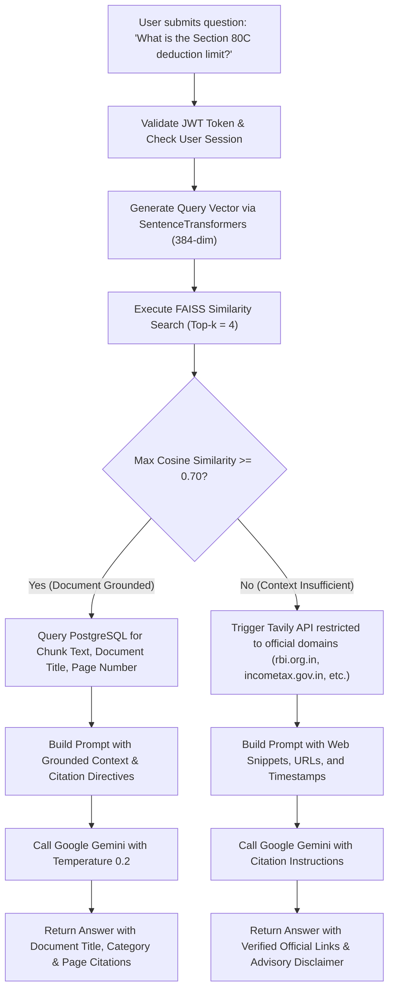

# FinanceAI – System Architecture & Technical Specifications

> **Academic Final-Year Project Specification (MCA)**  
> **Topic:** FinanceAI – An LLM-Based Domain-Specific Financial Assistant Using Retrieval-Augmented Generation (RAG)

---

## 1. Architectural Principles

1. **Information Grounding Over Extrapolation:** The system treats user questions in the financial domain with strict grounding requirements. Queries must either match indexed regulatory documents with page-level citations or trigger an official web search fallback.
2. **Decoupled Responsibilities:**
   - **Frontend (Presentation):** React.js single-page application managing UI state, JWT interceptors, and chat rendering.
   - **Backend (Orchestration):** FastAPI handling authentication, rate limiting, RAG context assembly, and LLM communication.
   - **Persistence (PostgreSQL + pgvector):** System of record for users, chat sessions, chunks, and embeddings accessed via raw `psycopg` connection pools.
   - **Search Cache (FAISS):** Local in-memory vector index providing sub-10ms nearest-neighbor similarity lookups.
3. **Defense-in-Depth Security:**
   - Parameterized SQL queries preventing SQL injection without ORM overhead.
   - Password hashing via `bcrypt` with work factor 12.
   - Role-based route authorization enforced via FastAPI dependencies.
   - User-isolated database queries ensuring no cross-user session leakage.

---

## 2. High-Level Architecture Diagram

```mermaid
flowchart TB
    subgraph Client ["Client Layer (React.js SPA)"]
        UserDashboard["User Chat Dashboard"]
        AdminDashboard["Admin Document Management"]
        AuthContext["Auth Context & Token Interceptor"]
    end

    subgraph Gateway ["Application Gateway (FastAPI)"]
        CORSMiddleware["CORS & Security Middleware"]
        AuthRouter["/api/v1/auth (JWT)"]
        ChatRouter["/api/v1/chat (RAG Context)"]
        DocRouter["/api/v1/documents (PDF Processing)"]
        AdminRouter["/api/v1/admin (Observability)"]
        FeedbackRouter["/api/v1/feedback (Audit & Ratings)"]
    end

    subgraph RAGCore ["RAG & AI Services"]
        PDFParser["PyMuPDF (fitz) Parser"]
        Chunker["Sliding Window Chunker (~800 chars, ~100 overlap)"]
        Embedder["SentenceTransformer (all-MiniLM-L6-v2)"]
        FAISSIndex["FAISS Vector Index (In-Memory)"]
        GeminiLLM["Google Gemini API (Grounded Prompting)"]
        TavilySearch["Tavily Search Engine (Official Portals)"]
    end

    subgraph DataTier ["Data & Persistence Tier"]
        PostgresDB[("PostgreSQL Database (Direct psycopg)")]
        PGVectorExt[("pgvector Extension (384-dim Embeddings)")]
        DiskStorage[("Local File Storage (/storage/docs & /storage/indices)")]
    end

    Client -->|REST API over HTTPS| Gateway
    Gateway --> RAGCore
    RAGCore --> DataTier
```



---

## 3. RAG Pipeline & Retrieval Decision Logic



---

## 4. Dual-Vector Synchronization: PostgreSQL vs. FAISS

A central design requirement is avoiding vector divergence and orphan records across vector backends:

```
[ PDF Upload ]
      │
      ▼
[ PyMuPDF Text Extraction & Cleaning ]
      │
      ▼
[ Recursive Sliding-Window Chunking ]
      │
      ▼
[ SentenceTransformers Embedding Generation (384-dim) ]
      │
      ├────────────────────────────────────────────────┐
      ▼                                                ▼
[ PostgreSQL: document_chunks ]            [ FAISS: IndexIDMap2 ]
- Durable on-disk storage                   - In-memory high-speed search
- Stores chunk_text, page_number, doc_id    - Maps vector to PostgreSQL chunk_id
- HNSW index on VECTOR(384)                 - Sub-10ms similarity queries
- Cascade deleted on doc removal            - Persisted to disk as finance_index.faiss
```

### Synchronization Rules:
1. **Insertion:** When chunks are committed to PostgreSQL, their generated `BIGSERIAL id` values are used as external IDs in `faiss.IndexIDMap2.add_with_ids()`.
2. **Deletion:** Removing a document in PostgreSQL triggers an `ON DELETE CASCADE` on `document_chunks`. The service simultaneously calls `faiss.remove_ids()` or reloads the index.
3. **Cold Starts:** If `finance_index.faiss` is missing or corrupted at startup, the system loads all embeddings from PostgreSQL via `SELECT id, embedding FROM document_chunks` and re-indexes them in seconds.

---

## 5. Security & Isolation Controls

| Threat Category | Potential Risk | Architectural Mitigation |
| :--- | :--- | :--- |
| **SQL Injection** | Attacker injects malicious SQL into input fields. | All database queries use parameterized SQL (`psycopg` placeholders `%s`). No raw string formatting or dynamic SQL concatenation. |
| **Cross-User Leakage** | User accesses another user's conversations or feedback. | Every chat query strictly enforces `WHERE user_id = :authenticated_user_id` extracted directly from the verified JWT payload. |
| **Document Tampering** | Unauthorized user uploads arbitrary files to the RAG pipeline. | The `/api/v1/documents/upload` endpoint requires the `admin` role and enforces magic-byte PDF validation and size limits (25MB). |
| **Financial Hallucination** | Model invents nonexistent tax exemptions or interest rates. | Low LLM temperature (`0.2`), strict system prompt instructions, explicit page citations, and fallback to official `.gov.in` web sources. |
| **Secret Exposure** | Leaked API keys or database credentials in client code or Git. | All sensitive values stored in backend `.env` read via Pydantic `BaseSettings`. Client only receives ephemeral JWT tokens. |

